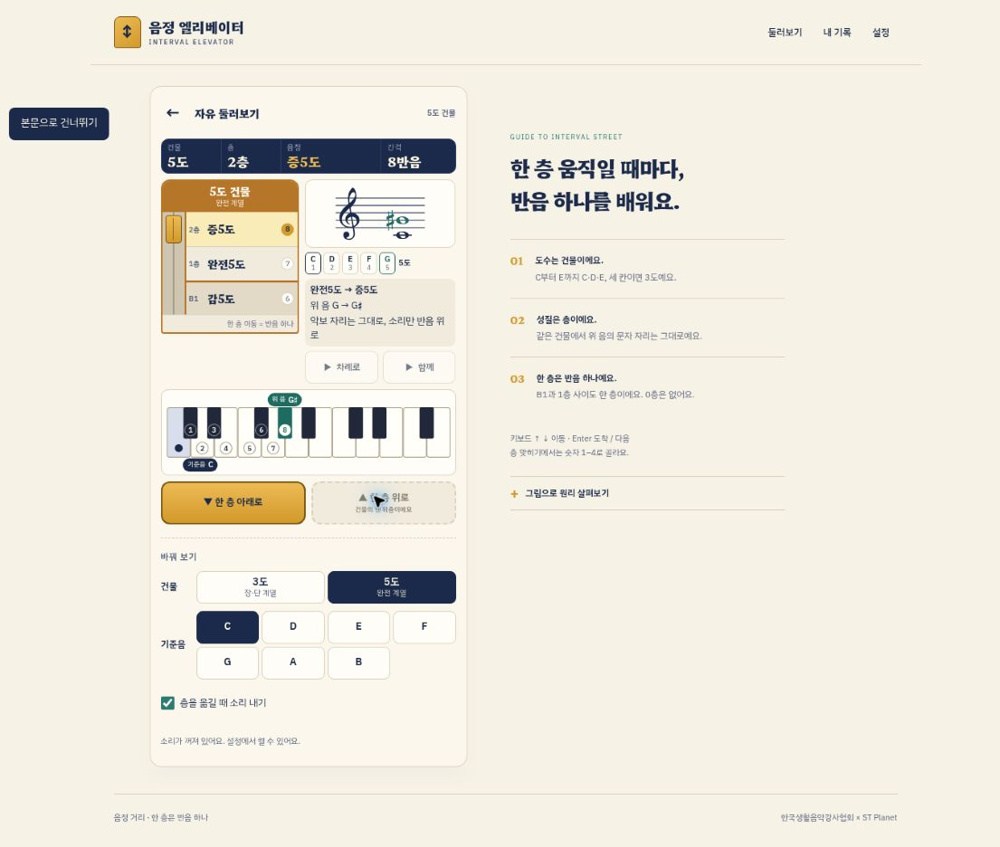

# 음정 엘리베이터 — 완료 기준 확인표

기준일: 2026-11-12. 기획서 12장과 프롬프트 14단계의 기준으로 확인했습니다.

## 자동 검사

- `npm test`: 42개 통과. 원본 엔진 golden 20개, 저장·설정 11개, 악보·건반·정답 가림 렌더링 11개입니다.
- `npm run build`: 오류·경고 없이 통과했습니다. 27개 정적 페이지를 내보냈으며 14개 미션과 4개 단계 주소를 포함합니다.
- Next.js의 TypeScript strict 검사를 통과했습니다.
- 원본과 바이트 비교: `engine.ts`, `engine.golden.test.ts`, golden JSON, `make-golden.ts` 네 파일 모두 변경하지 않았습니다.

## 브라우저에서 확인한 흐름

| 항목 | 확인한 결과 | 상태 |
| --- | --- | --- |
| 1~4단계 안내 | 네 안내 대본의 next/up/down/listen/base/reach 조건을 실제 조작했습니다. 3단계에서 3층까지, 4단계에서 B1까지 도착해야 넘어갑니다. | 통과 |
| 예시 A: 단3도 → 장3도 | C–E 플랫 → C–E, 1층 → 2층, 3 → 4반음이 함께 바뀌었습니다. | 통과 |
| 기준음 D | D–F → D–F 샵으로 장3도가 되며 위 음의 문자 자리를 유지했습니다. | 통과 |
| 예시 B: 완전5도 → 증5도 | C–G → C–G 샵, 7 → 8반음. A 플랫으로 재표기되지 않았습니다. | 통과 |
| 예시 C: 같은 소리 다른 도수 | C–E 플랫에서 증2도를 선택해 ‘도수부터 세어 봐요’, C·D·E와 지운 선택지 표시를 확인했습니다. | 통과 |
| 예시 D: 장→감 두 층 / 완전→감 한 층 | 3·4단계 안내의 비교 대사와 C–E 더블 플랫의 건반 D 자리, C–G 플랫의 B1을 확인했습니다. 4-3 전체 플레이는 별도 엔진 golden 검사로 검증했습니다. | 안내·엔진 통과 |
| B1 ↔ 1층 | 3·5도 건물에서 한 번 이동해 B1과 1층을 오갔으며 0층은 나타나지 않았습니다. | 통과 |
| 층 맞히기 답 가리기 | 시작할 때 층·음정·간격이 ?, 반음 수 접근성 이름도 숨겨지고 정답 뒤에 공개됐습니다. 총정리의 건물 숨김은 엔진과 렌더 검사로 확인했습니다. | 브라우저·자동 검사 통과 |
| 손님 모시기 힌트 | 1-2에서 첫 오답에 성질, 둘째에 반음, 셋째에 목적층 공개와 이동을 확인했습니다. 같은 자리의 ‘도착’은 다시 누를 수 없었습니다. | 통과 |
| 공개 이동 | 1층 → 2층 공개 중 다음 버튼이 잠기고 이동을 마친 뒤 열렸습니다. 여러 층 공개는 구현과 엔진 검사로 확인했으며 별도 전체 플레이는 하지 않았습니다. | 1층 이동 확인 |
| 별·필수 다시 풀기 | 1-1 첫 정답 3/4 → 별 2개, 틀린 유형 1문제 복습 후에만 완료 가능했습니다. 1-2는 1/2·이동7/최단2 → 별1개, 복습 후에도 본 문제의 별을 유지했습니다. | 통과 |
| 저장·중복 기록 | 내 기록에서 안내·층 맞히기·손님 모시기가 각 플레이1회로 저장됐습니다. 새 페이지 로드 뒤에도 남았습니다. 저장 차단·손상·용량 부족은 저장 검사로 확인했습니다. | 통과 |
| 수업 링크 | 설정에서 만든 `?open=3&sound=off`로 3단계 이동, 3-0만 열림·3-1 잠김, 소리 꺼짐을 확인했습니다. | 통과 |
| QR | SVG 생성, 크게 보기 모달, 닫기와 전체 주소 표시를 확인했습니다. 카메라 스캔은 실제 기기 확인이 필요합니다. | 화면 통과 |
| 무음 진행 | 소리 끔 상태에서 듣기 버튼은 비활성화되고 1-0 듣기 단계에는 다음 버튼이 나타났으며 안내를 끝낼 수 있었습니다. | 통과 |
| 키보드 | 버튼에 초점이 있어도 ↑ 이동이 안내를 진행했습니다. 1~4·Enter의 이벤트 연결은 코드 검토와 엔진 검사로 확인했습니다. | ↑ 브라우저 확인 |

## 화면 크기와 접근성

동일 출처 iframe의 실제 뷰포트 390×844·360×640과 밝은/어두운 테마에서 확인했습니다. iframe 내부의 세로 스크롤바를 제외한 clientWidth와 scrollWidth가 일치해 가로 넘침이 없었습니다.

- 390px 안내 본체: 약 630.83px, 360px: 약 624.95px로 상단 미션 막대부터 이동 버튼까지 650px 안에 들어옵니다.
- 360px 손님 모시기 본체: 약 572.95px입니다.
- 확인한 듣기·안내 버튼은 높이44px 이상, 이동 버튼58px, 선택지56px 이상입니다.
- 긴 안내 글은 안에서 스크롤되며 다음 버튼은 고정된 영역에 보여 가려지지 않습니다.
- 밝은/어두운 색, 악보·건반의 읽기용 이름, 정답·오답의 글자와 기호, aria-live, 초점 표시, 움직임 줄이기를 제공합니다.
- 홈·둘러보기·층 맞히기·손님 모시기·결과·기록·설정을 확인했습니다. 4-3과 4-4를 포함한 모든 문제 미션을 브라우저에서 끝까지 플레이한 것은 아닙니다. 공통 UI와 원본 엔진 검사를 이용했습니다.

## 배포

[음정 엘리베이터](https://interval-elevator.augustrushkim.chatgpt.site)로 비공개 배포했습니다. 배포 서비스가 성공 상태를 반환했습니다. 공개 범위는 본인 전용으로 유지했습니다. 배포 주소의 브라우저는 ChatGPT 로그인 화면을 보였으므로 기능 흐름의 브라우저 검수는 같은 소스의 로컬 미리보기에서 수행했습니다.

현재 수업 링크와 QR도 배포본의 접근 범위를 따릅니다. 학생에게 공개하려면 별도의 공개 범위 변경이 필요합니다.

## 실제 기기 확인 필요

- 실제 iPhone iOS17 이상 무음 모드와 iOS16 이하 무음 스위치에서의 재생
- 실제 Galaxy/Android의 음질과 재생, 손가락 터치감과 글자 가독성
- 실제 카메라로 QR 열기와 홈 화면 아이콘 추가

